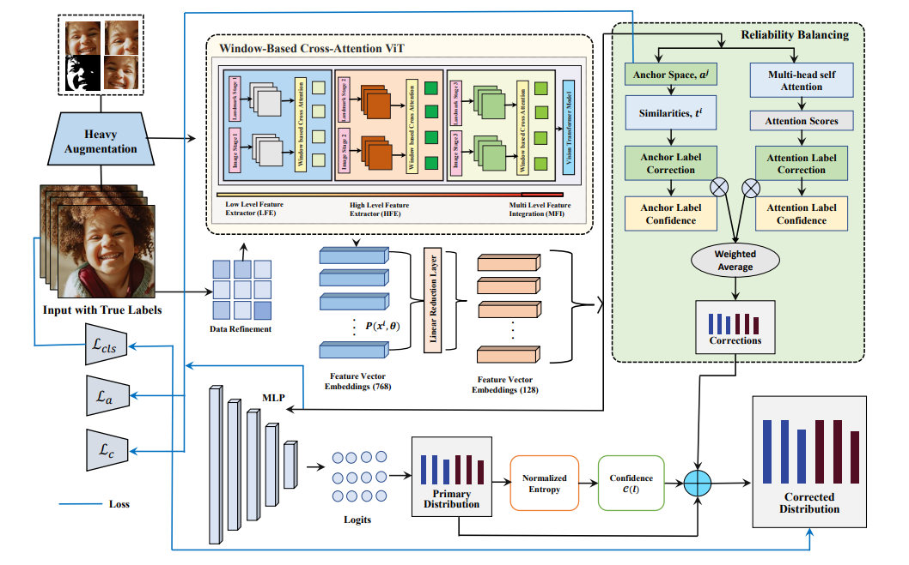
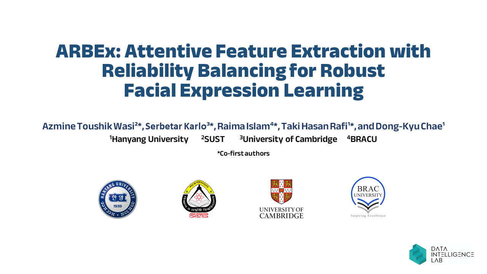

## [GReFEL: Geometry-Aware Reliable Facial Expression Learning Under Bias and Imbalanced Data Distribution](https://doi.org/10.1007/978-981-96-0911-6_27)
### Accepted at the Asian Conference on Computer Vision (ACCV 2024)
### [Azmine Toushik Wasi](https://azminewasi.github.io/)<sup>1\*</sup>, Taki Hasan Rafi<sup>2\*</sup>, Raima Islam<sup>3</sup>, Karlo Šerbetar<sup>4</sup>, and [Dong-Kyu Chae](https://dkchae.github.io/)<sup>2†</sup>

<sup>1</sup>Shahjalal University of Science and Technology, Bangladesh &nbsp;
<sup>2</sup>Hanyang University, South Korea &nbsp;
<sup>3</sup>Harvard University, USA &nbsp;
<sup>4</sup>University of Cambridge, United Kingdom

<sup>\*</sup>Co-first authors. <sup>†</sup>Correspondence to: `dongkyu@hanyang.ac.kr`

> GReFEL is the extended and peer-reviewed version of our earlier preprint, [ARBEx: Attentive Feature Extraction with Reliability Balancing for Robust Facial Expression Learning](https://arxiv.org/abs/2305.01486).

---

[](https://doi.org/10.1007/978-981-96-0911-6_27)
[](https://doi.org/10.1007/978-981-96-0911-6_27)
[](https://azminewasi.github.io/research/paper/arbex/)
[](https://arxiv.org/abs/2410.15927)
[](https://arxiv.org/pdf/2410.15927)
[](https://www.youtube.com/watch?v=I4HxYUhVd18&t=31s)
[](https://arxiv.org/abs/2305.01486)

---

## Architecture
Pipeline of GReFEL.
<p align="center">
  
</p>

## Setup and run
Put pretrained `ir50.pth` and `mobilefacenet.pth` into `arbex/models/pretrained`.
By default, data is assumed to be in `../../_DATA`. The code assumes `AffWild2` as the default dataset. If you intend to use other datasets, you may need to modify the data loading process in `arbex/data.py`.
To change the default paths, change `DIR_IMG`, `DIR_ANN_TRAIN`, `DIR_ANN_DEV` in `arbex/config.py`.

To install the dependencies, run:
```
pip install -r requirements.txt
```
To run the training script:
```
python train.py
```

## Working Principle
[](https://youtu.be/I4HxYUhVd18)

## Citation
If you use this code, please cite GReFEL:
```
@inbook{Wasi_2024,
   title={GReFEL: Geometry-Aware Reliable Facial Expression Learning Under Bias and Imbalanced Data Distribution},
   ISBN={9789819609116},
   ISSN={1611-3349},
   url={http://dx.doi.org/10.1007/978-981-96-0911-6_27},
   DOI={10.1007/978-981-96-0911-6_27},
   booktitle={Computer Vision – ACCV 2024},
   publisher={Springer Nature Singapore},
   author={Wasi, Azmine Toushik and Rafi, Taki Hasan and Islam, Raima and Šerbetar, Karlo and Chae, Dong-Kyu},
   year={2024},
   month=dec,
   pages={465–482}
}
```

Earlier preprint (ARBEx):
```
@misc{wasi2023arbex,
      title={ARBEx: Attentive Feature Extraction with Reliability Balancing for Robust Facial Expression Learning},
      author={Azmine Toushik Wasi and Karlo Šerbetar and Raima Islam and Taki Hasan Rafi and Dong-Kyu Chae},
      year={2023},
      eprint={2305.01486},
      archivePrefix={arXiv},
      primaryClass={cs.CV}
}
```

## References
[POSTER_V2](https://github.com/talented-q/poster_v2) \
[ViT](https://github.com/huggingface/pytorch-image-models)